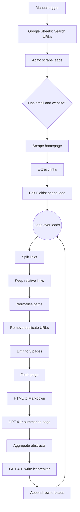

# 01 · Deep Multiline Icebreaker

An n8n workflow that turns a lead list into **deeply personalised cold-email openers**. It scrapes leads from a search URL, visits each lead's website, reads several of its pages, summarises them with GPT-4.1, and writes a multi-line icebreaker that proves "I actually read your site". Results are appended to a Google Sheet, ready to drop into a cold-email tool.

> **Credits:** the multiline-icebreaker pattern is widely shared in the n8n and lead-generation community and this workflow builds on it.

## What it does

1. Reads search URLs from a Google Sheet.
2. Calls an Apify lead-scraper actor for each URL (up to 500 records) and keeps only leads that have **both** an email and a website.
3. Fetches each lead's homepage and collects its internal links.
4. For every lead, takes up to **3 internal pages**, converts each to Markdown, and has GPT-4.1 write a two-paragraph abstract of each page.
5. Combines the abstracts and has GPT-4.1 write a short, specific, multi-line icebreaker using a fixed template.
6. Appends the lead plus the icebreaker to the `Leads` sheet.

## Workflow diagram



## Before you start

| You need | Notes |
|---|---|
| n8n (Cloud or self-hosted) | See [common setup](../docs/common-setup.md) |
| Google account | Google Sheets OAuth2 credential |
| OpenAI API key | Used by both GPT-4.1 nodes (OpenAI credential) |
| Apify account and API token | Used by the **Call Apify Scraper** node |
| A lead-source search URL | The Apify actor in this workflow takes a search URL (for example an Apollo-style people search) and returns people with emails and organisation websites |

## Setup

1. **Import** `workflow.json` into n8n.
2. **Create the Google Sheet** with two tabs from the [`sheets/`](./sheets) folder:
   - `Search URLs`: one column `URL`. Add one search URL per row.
   - `Leads`: output tab. Columns: `first_name, last_name, email, website_url, phone_number, location, multiline_icebreaker`.
3. **Connect credentials**
   - Both Google Sheets nodes (**Get Search URL**, **Add Row**): Google Sheets OAuth2.
   - Both OpenAI nodes (**Summarize Website Page**, **Generate Multiline Icebreaker**): OpenAI API.
4. **Point the Google Sheets nodes at your sheet.** The document ID is a `YOUR_GOOGLE_SHEET_ID` placeholder. Select your sheet in each node.
5. **Add your Apify token.** In **Call Apify Scraper**, replace `Bearer YOUR_APIFY_API_TOKEN` in the `Authorization` header (or switch the node to a Header Auth credential).
6. **Check the actor.** The URL contains an Apify actor ID. Use the actor you have access to, and adjust the JSON body if its input fields differ.
7. **Rewrite the pitch** in the **Generate Multiline Icebreaker** prompt (see below).
8. Click **Test workflow**. Start with one search URL and a low `totalRecords` value.

## Configuration reference

| Setting | Where | Default |
|---|---|---|
| Records per search URL | `totalRecords` in the **Call Apify Scraper** JSON body | `500` |
| Emails requested | `getPersonalEmails`, `getWorkEmails` in the same body | both `true` |
| Pages read per lead | **Limit** node, `maxItems` | `3` |
| Model | Both OpenAI nodes | `gpt-4.1` |
| Lead filter | **Only Websites & Emails** node | email and website must exist |

## Node breakdown

| Node | Purpose |
|---|---|
| **When clicking 'Test workflow'** | Manual start |
| **Get Search URL** | Reads the `Search URLs` tab |
| **Call Apify Scraper** | Synchronous Apify call that returns lead records |
| **Only Websites & Emails** | Drops leads without an email or website |
| **Scrape Home / HTML** | Downloads the homepage and extracts every `<a href>` |
| **Edit Fields** | Maps first name, last name, email, website, location and phone into a clean record |
| **Loop Over Items** | Processes leads one at a time |
| **Split Out / Filter / Code** | Turns the link array into items and keeps relative links, normalised to a path |
| **Remove Duplicate URLs / Limit** | De-duplicates and keeps the first 3 pages |
| **Request web page for URL / Markdown** | Fetches each page and converts it to Markdown |
| **Summarize Website Page** | GPT-4.1 returns `{"abstract": ...}` (two paragraphs, spartan tone) |
| **Aggregate** | Collects the page abstracts for a lead |
| **Generate Multiline Icebreaker** | GPT-4.1 returns `{"icebreaker": ...}` using a fixed template |
| **Add Row** | Appends the finished lead to `Leads` |

## The prompts

**Page summariser.** Input is the Markdown of one page. Output is JSON with a comprehensive two-paragraph abstract, written in a "straightforward, spartan tone", or `no content` for empty pages.

**Icebreaker writer.** Takes the abstracts and fills a fixed multi-line template: a short greeting that name-drops one small, non-obvious detail from the site, a line admitting you looked closely, and a one-sentence pitch. Rules baked into the prompt:

- spartan, laconic tone
- shorten company names and locations ("XYZ" not "XYZ Agency", "San Fran" not "San Francisco")
- use small, non-obvious details; no cookie-cutter praise like "Love your website!"

## Example output row

| first_name | email | website_url | multiline_icebreaker |
|---|---|---|---|
| Sam | sam@example.com | https://example.com | `Hey Sam. Love {small detail}, also a fan of {other detail}. Wanted to run something by you. ...` |

## Known limitations

- **Empty company name in the prompt.** The icebreaker prompt starts with "a business called ." because the company-name variable is missing. Add an organisation-name field in **Edit Fields** and reference it in the prompt.
- **The pitch text is a placeholder.** The template's pitch line describes a different product (an outreach system for finding people hiring web developers). Rewrite it for your own offer before sending anything.
- **Only relative links are followed.** Absolute links (including links to subdomains) are dropped, so a few sites will yield fewer than 3 pages.
- **Synchronous Apify call.** `run-sync-get-dataset-items` times out on long runs. For large lists, lower `totalRecords` or switch to an asynchronous run and poll for results.
- **Cost.** Every lead triggers up to 3 page summaries plus 1 icebreaker with GPT-4.1. Keep `totalRecords` low while testing.
- **Secrets.** The Apify token sits in a header on the node. Move it to a credential.

## Files

```
01-deep-multiline-icebreaker/
├── README.md
├── workflow.json
└── sheets/
    ├── Search URLs.csv
    └── Leads.csv
```
