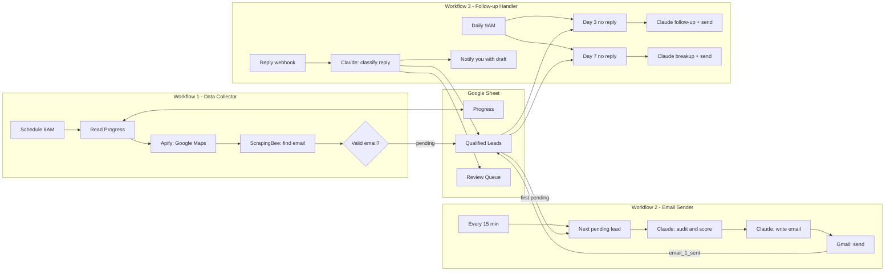

# 02 · Local Business Audit & Outreach Pipeline

A three-workflow n8n system that **finds local businesses, audits them with AI, sends a personalised cold email, follows up automatically, and triages replies**. The workflows are decoupled and communicate only through one Google Sheet, so each can be run, paused or debugged on its own.

| Workflow | File | Schedule | Job |
|---|---|---|---|
| **1 · Data Collector** | [`01-data-collector.json`](./workflows/01-data-collector.json) | Weekdays 8AM | Scrape Google Maps, extract emails, save qualified leads |
| **2 · Email Sender** | [`02-email-sender.json`](./workflows/02-email-sender.json) | Every 15 min, 9AM to 6PM weekdays | Audit one pending lead with Claude, write and send the first email |
| **3 · Follow-up Handler** | [`03-followup-handler.json`](./workflows/03-followup-handler.json) | Weekdays 9AM, plus a reply webhook | Day 3 follow-up, day 7 breakup email, reply analysis |

## Architecture



## Lead lifecycle

`pending` → `email_1_sent` → `followup_1_sent` → `sequence_complete`

A reply moves the lead to `interested`, `ready_for_audit`, `replied_followup_needed` or `opted_out` and sets `replied = true`, which stops further follow-ups.

## Before you start

| You need | Used by |
|---|---|
| n8n (Cloud or self-hosted), see [common setup](../docs/common-setup.md) | all |
| Google Sheets OAuth2 credential | all |
| Gmail OAuth2 credential | workflows 2 and 3 |
| [Apify](https://apify.com) API token (Google Maps crawler actor `compass~crawler-google-places`) | workflow 1 |
| [ScrapingBee](https://www.scrapingbee.com) API key | workflow 1 |
| [Anthropic](https://console.anthropic.com) API key | workflows 2 and 3 |
| Something that forwards email replies to the webhook (see below) | workflow 3, optional |

## Setup

### 1. Create the Google Sheet

Import the three CSVs in [`sheets/`](./sheets) as tabs with exactly these names:

- **`Progress`**: one row (`id = 1`) that stores where the crawler is. Workflow 1 reads and updates it.
- **`Qualified Leads`**: every lead and its status. All three workflows read and write it.
- **`Review Queue`**: replies that need a human, with an AI-drafted response.

### 2. Import the workflows

Import all three files from [`workflows/`](./workflows). Do not activate them yet.

### 3. Fill in each Set Config node

| Workflow | Fields to edit |
|---|---|
| 1 · Data Collector | `apify_key`, `scrapingbee_key`, `google_sheet_id`, `niches` |
| 2 · Email Sender | `anthropic_key`, `google_sheet_id`, `sender_email`, `sender_name` |
| 3 · Follow-up Handler | `anthropic_key`, `google_sheet_id`, `sender_email` |

Workflow 3 also has a **Find Lead By Email** node containing `=YOUR_GOOGLE_SHEET_ID_HERE`. Replace it with your sheet ID, and replace `YOUR_EMAIL@example.com` in **Gmail - Notify Ayo** with the address that should receive reply alerts.

### 4. Attach credentials

- Every **Google Sheets** node: Google Sheets OAuth2.
- Every **Gmail** node: Gmail OAuth2.

### 5. Test in this order

1. Run workflow 1 manually. Confirm rows appear in `Qualified Leads` with `status = pending`.
2. **Deactivate the Gmail send node** in workflow 2, or temporarily change the recipient to your own address, then run it once and read the subject, body and score.
3. Re-enable sending. Run workflow 3 manually to check the filters (it only acts on leads emailed 3 or 7 or more days ago).
4. Activate all three.

### 6. Reply handling (optional)

Workflow 3 exposes `POST /webhook/email-reply-webhook` and expects JSON with two fields:

```json
{ "from": "owner@business.com", "message": "Sounds interesting, send it over" }
```

n8n does not receive Gmail replies on its own. Pick one:

- Add a **Gmail Trigger** node (or a second small workflow) that POSTs each new reply to the webhook, or
- Forward replies from Zapier, Make or an Apps Script.

Without this, nothing sets `replied = true` automatically, so you must set it by hand to stop follow-ups.

## Workflow 1 · Data Collector

1. **Schedule** at 8AM on weekdays.
2. **Read Progress** loads the current town index and niche index. The built-in list has about 237 towns across the US, UK, Australia and Canada and 9 niches (dental clinic, medical clinic, hair salon, HVAC company, plumber, law firm, real estate agent, gym, restaurant).
3. **Apify** searches Google Maps for `{niche} {town} {state} {country}` and returns up to 10 places.
4. Keeps places that have a name and a website.
5. Waits 3 seconds, then **ScrapingBee** fetches the site and extracts `mailto:` links plus a simple call-to-action signal.
6. Keeps leads with a valid email, excluding `noreply`, `no-reply`, `donotreply`, `webmaster@` and `postmaster@`.
7. Appends the lead to `Qualified Leads` with `status = pending`, then advances `Progress` to the next niche (and the next town once all niches are done).

## Workflow 2 · Email Sender

1. Runs every 15 minutes between 9AM and 6PM on weekdays (cron `*/15 9-18 * * 1-5`).
2. Picks the first `Qualified Leads` row with `status = pending`. If there is none, it stops.
3. **Claude audit.** Scores the business out of 100 and returns JSON with a grade, findings, recommendations, pain points and a one-line pitch angle.
4. **Claude email.** Writes a personalised cold email of at most 120 words (JSON with `subject` and `body`).
5. Updates the sheet (`email_1_sent`, subject, body, score, grade, `analysis_json`, `date_emailed`), then sends through Gmail.

Throughput is one lead per tick, so at most about 40 emails per weekday.

### Audit scoring rubric

| Signal | Max points |
|---|---|
| Google review count | 25 |
| Review rating | 15 |
| Owner response rate | 15 |
| Photo count | 10 |
| Website quality (has a call-to-action) | 20 |
| Business description | 5 |
| Call answering | 10 (see limitations) |

The model also assigns a category: `needs_website`, `needs_ai_receptionist` or `needs_both`, which steers the angle of the email.

## Workflow 3 · Follow-up Handler

Three independent branches:

- **Day 3.** Leads with `status = email_1_sent`, at least 3 days since `date_emailed`, and not replied. Claude writes a follow-up of under 80 words with one new angle. Sends it and sets `followup_1_sent`.
- **Day 7.** Leads with `status = followup_1_sent`, at least 7 days since `date_emailed`, and not replied. Claude writes a warm breakup email of under 60 words. Sends it and sets `status = sequence_complete`.
- **Replies.** The webhook receives a reply, waits 1 minute, finds the lead by email, and asks Claude to classify the sentiment (`POSITIVE`, `NEUTRAL`, `NEGATIVE`, `READY`) and draft a response of under 100 words. The lead row is updated, the reply is appended to `Review Queue`, and you get an email with the draft. **Nothing is sent to the lead automatically.** A human approves every reply.

## Data schema

**Qualified Leads** (key columns)

| Column | Written by | Meaning |
|---|---|---|
| `business_name, email, phone, website, address, town, state, country, niche, category` | W1 | Lead details |
| `rating, review_count, photos_count, description, owner_answers, has_cta` | W1 | Signals used by the audit |
| `status` | W1, W2, W3 | Lifecycle state (see above) |
| `replied, reply_sentiment` | W3 | Reply tracking |
| `total_score, grade, analysis_json` | W2 | AI audit result |
| `email_subject, email_body` | W2 | The first email as sent |
| `date_added, date_emailed` | W1, W2 | Timestamps used by the follow-up filters |
| `followup_1_sent, followup_2_sent` | W3 | Follow-up flags |

## Known limitations

- **The "call test" is not real.** The audit and email prompts assume that you tried to phone the business and nobody answered, and instruct the model to mention it. None of these workflows places a call, and the score for that item is hard-coded. Either add a real calling step (for example an AI receptionist test call) or remove those lines from the prompts. Otherwise the emails state something that did not happen.
- **No duplicate check in workflow 1.** The earlier single-workflow version checked for an existing email before saving. Add a lookup on `Qualified Leads` before **Save to Qualified Leads** if the same business can appear in several searches.
- **Slow coverage by default.** Workflow 1 runs one niche and town per run, once per weekday. Roughly 2,100 town and niche combinations would take years at that pace. Raise the trigger frequency once you are happy with lead quality.
- **`total_leads` is read but never incremented.**
- **Status is updated before the email is sent.** If Gmail fails, the lead is already marked `email_1_sent`.
- **Weak website signal.** `has_cta` is a rough selector check (booking, appointment or contact links, or any button), so treat the website score as indicative only.
- **Replies need an external forwarder** (see Setup, step 6).
- **API keys sit in Set Config nodes.** Move them to credentials before sharing exports.
- **Deliverability.** Use a dedicated sending domain, warm it up, and keep volumes low. Include a clear way to opt out.

## Evolution of this system

1. **v1** · A single weekly workflow: Outscraper for Google Maps, ScrapingBee for emails, Claude for audit and email, with 20-minute waits and a 3-day and 7-day follow-up inside the same execution.
2. **Data collection v1** · Split lead collection into its own all-states workflow using SerpApi and a 30-minute batch interval.
3. **FINAL** · Moved to Apify, added a rotating town and niche progress tracker, a duplicate-email check and a webhook for replies, still in one workflow.
4. **FINAL v2** · Expanded the town list from about 200 to about 530 towns.
5. **Current (this folder)** · Split into three decoupled workflows connected through the sheet, which makes each part easy to run and debug on its own.

For the version that adds SMS and Groq, see [03 · Multi-Channel Audit Outreach](../03-multichannel-audit-outreach).

## Files

```
02-audit-outreach-pipeline/
├── README.md
├── workflows/
│   ├── 01-data-collector.json
│   ├── 02-email-sender.json
│   └── 03-followup-handler.json
└── sheets/
    ├── Progress.csv
    ├── Qualified Leads.csv
    └── Review Queue.csv
```
