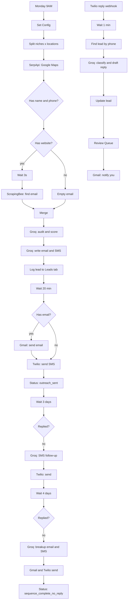

# 03 · Multi-Channel Audit Outreach (Email + SMS, Groq)

A single long-running n8n workflow that runs the **audit-and-outreach** idea across **two channels**. It finds local businesses on Google Maps, scores them with an LLM, then contacts them by email and SMS, follows up, and handles SMS replies through a Twilio webhook.

This version runs entirely on **Groq's Llama 3.3 70B** (`llama-3.3-70b-versatile`) through Groq's OpenAI-compatible API, so there is no Anthropic or OpenAI key to manage. For the more modular, email-only design, see [02 · Audit & Outreach Pipeline](../02-audit-outreach-pipeline).

## What it does

1. **Weekly trigger** (Monday 9AM) loops over 9 niches × 9 locations (81 searches) using SerpApi's Google Maps engine, 10 results each.
2. Keeps businesses that have a **name and a phone number**.
3. If a business has a website, waits 3 seconds and uses **ScrapingBee** to pull a contact email and a call-to-action signal. If not, the email stays empty.
4. **Groq audit.** Scores the business out of 100 and returns a grade, findings, pain points and a pitch angle.
5. **Groq copy.** Writes a cold email (at most 120 words) and an SMS (at most 160 characters) in one call.
6. Logs the lead to the `Leads` tab, waits 20 minutes, then:
   - sends the email through Gmail (if an email was found), and
   - sends the SMS through Twilio.
7. **Day 3:** if there is no reply, sends an SMS follow-up.
8. **Day 7:** if still no reply, sends a breakup email and a breakup SMS, then marks the lead `sequence_complete_no_reply`.
9. **Replies** (separate branch): Twilio posts incoming SMS to an n8n webhook. Groq classifies the reply and drafts a response, the lead is updated, the reply goes into `Review Queue`, and you receive an email alert. Nothing is auto-sent back to the lead.

## Workflow diagram



## Before you start

| You need | Notes |
|---|---|
| n8n (Cloud or self-hosted) | See [common setup](../docs/common-setup.md). Needs a publicly reachable URL for the Twilio webhook |
| Google Sheets and Gmail OAuth2 credentials | |
| [SerpApi](https://serpapi.com) key | Google Maps search |
| [ScrapingBee](https://www.scrapingbee.com) key | Email extraction from websites |
| [Groq](https://console.groq.com) API key | LLM calls |
| [Twilio](https://www.twilio.com) account, SMS-capable number | Outbound SMS and inbound reply webhook |

## Setup

1. **Import** [`workflow.json`](./workflow.json).
2. **Create the Google Sheet** with the two tabs in [`sheets/`](./sheets): `Leads` and `Review Queue`.
3. **Fill in the Set Config node.**

   | Field | Value |
   |---|---|
   | `niches`, `locations` | Arrays of search terms. Defaults: 9 niches and 9 cities across the US, UK, Australia and Canada |
   | `sender_name`, `sender_email` | Your name and reply-to address |
   | `serpapi_key`, `scrapingbee_key`, `groq_key` | Your API keys |
   | `google_sheet_id` | The ID of your sheet |
   | `twilio_account_sid`, `twilio_auth_token`, `twilio_phone` | Twilio details; `twilio_phone` is your sending number in E.164 format (`+15551234567`) |

4. **Groq reply node.** In **Groq - Analyse Reply**, replace `YOUR_GROQ_API_KEY_HERE` in the `Authorization` header with your key. (This node runs from the webhook branch, so it cannot read `groq_key` from Set Config.)
5. **Twilio credential.** Create an **HTTP Basic Auth** credential (username = Account SID, password = Auth Token) and attach it to the three Twilio nodes: **Twilio - Send SMS**, **Twilio - Send SMS Follow-up 1**, **Twilio - Send Breakup SMS**.
6. **Google credentials.** Attach Google Sheets OAuth2 to every Sheets node and Gmail OAuth2 to the Gmail nodes.
7. **Notification address.** In **Gmail - Notify Ayo**, replace `YOUR_EMAIL@example.com`.
8. **Webhook.** Activate the workflow, copy the **Production URL** of **Twilio Reply Webhook** (`/webhook/twilio-reply-webhook`), and in the Twilio console set it as the "A message comes in" webhook (HTTP POST) for your number. Twilio sends `From` and `Body`, which the workflow reads.
9. **Test small first.** Shrink `niches` and `locations` to one each, and deactivate the Gmail and Twilio send nodes (or use your own email and phone) for the first run.

## Configuration reference

| Setting | Where | Default |
|---|---|---|
| Schedule | **Weekly Trigger** | `0 9 * * 1` (Monday 9AM) |
| Results per search | SerpApi `num` parameter | `10` |
| Delay before sending | **Wait 20 Minutes** | 20 minutes |
| Follow-up timing | **Wait 3 Days**, **Wait 4 More Days** | Day 3, Day 7 |
| Model | All Groq nodes | `llama-3.3-70b-versatile` |
| Scrape rate limit | **Wait 3 Seconds (Rate Limit)** | 3 seconds |

## Sheet schema

**Leads**: `business_name, email, phone, website, has_website, address, location, niche, rating, review_count, hours, category, total_score, grade, analysis_json, email_subject, email_body, sms_body, status, replied, reply_sentiment, audit_sent, date_added`

Status values: `pending_send`, `outreach_sent`, `sequence_complete_no_reply`, `opted_out`, `ready_for_audit`, `replied_needs_followup`.

**Review Queue**: `business_name, phone, their_reply, sentiment, suggested_reply, action, reviewed, timestamp`

Leads are matched by `phone`, so each business needs a unique phone number in the sheet.

## Known limitations

- **The "call test" is not real.** The audit, email and SMS prompts assume you tried to phone the business and nobody answered, and tell the model to mention the "missed call". No node in this workflow places a call, and the call-answering score is hard-coded. Either add a real calling step or remove those lines from the prompts, otherwise the messages state something that did not happen.
- **Phone numbers are not normalised.** Google Maps returns numbers in local formats, but Twilio needs E.164 (`+15551234567`). Add a formatting step before **Twilio - Send SMS**, or sends will fail.
- **Landlines can't receive SMS.** Many business listings are landlines, so expect a share of delivery failures.
- **The 20-minute wait delays, it doesn't space.** The Wait node holds all items for the same interval and releases them together. To throttle sending, add **Loop Over Items** with a Wait inside the loop.
- **`your_whatsapp` and the WhatsApp idea are unused.** The field is passed along but no node sends WhatsApp messages.
- **Follow-up 1 is SMS only.** Day 3 sends no email, only an SMS.
- **Long executions.** Each lead waits 7 days inside one execution, so a big run leaves many executions in "waiting". Check your n8n execution retention and database size.
- **Reply matching depends on the phone number.** Replies from a different number than the one in the sheet won't match a lead.
- **SMS is the most heavily regulated channel.** In many countries, including the US (TCPA), commercial texts need prior consent or specific safeguards, and opt-out handling is mandatory. Get advice before texting at volume.
- **API keys in Set Config.** Move them to credentials before sharing exports.

## Evolution

1. **v1** · Outscraper for Google Maps, ScrapingBee for emails, Claude for audit and copy. Email only, with 20-minute waits and day 3 and day 7 follow-ups.
2. **v2** · Added Twilio SMS, a Twilio reply webhook, reply classification and a `Review Queue`. Used Outscraper's own email field as a shortcut before scraping the site.
3. **v3** · Replaced Outscraper with SerpApi's Google Maps engine and added an email alert for new replies.
4. **v4 (this folder)** · Replaced Claude with Groq's Llama 3.3 70B and added a 3-second delay before scraping to stay within rate limits.

## Files

```
03-multichannel-audit-outreach/
├── README.md
├── workflow.json
└── sheets/
    ├── Leads.csv
    └── Review Queue.csv
```
