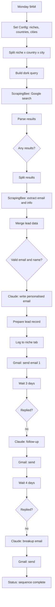

# 04 · AI Lead Gen & Cold Email (Google Dorking)

An n8n workflow that finds local businesses **without the Google Maps API**. It builds Google search-operator queries ("dorks") per niche and city, scrapes the results, pulls a contact email from each site, has Claude write a personalised pitch for an **AI phone agent**, sends it through Gmail, and follows up automatically.

## What it does

1. **Weekly trigger** (Monday 9AM).
2. **Set Config** holds 9 niches, each with its own dork string (for example `"dental clinic" ("book appointment" OR "contact us" OR "schedule")`), and 4 countries (US, UK, Australia, Canada), each with a country-specific Google domain and 5 cities.
3. **Build Dork Query** combines niche, city and a block of exclusions (`-site:yelp.com -site:yellowpages.com -site:tripadvisor.com -site:healthgrades.com -site:thumbtack.com -site:angi.com`) so results are real business sites rather than directories.
4. **ScrapingBee** loads the Google results page (top 5) with CSS extraction rules for title, URL and snippet.
5. Each result is fetched again to extract a contact email and basic info.
6. Keeps leads with a valid email and a business name.
7. **Claude** writes a personalised email (at most 150 words) using the business name, niche, city and the site snippet.
8. Logs the lead to a **sheet tab named after the niche**, then sends the email.
9. **Day 3:** if `replied` is not `true`, Claude writes a short follow-up. **Day 7:** a breakup email. Then the lead is marked complete.

## Workflow diagram



## Before you start

| You need | Notes |
|---|---|
| n8n (Cloud or self-hosted) | See [common setup](../docs/common-setup.md) |
| Google Sheets and Gmail OAuth2 credentials | |
| [ScrapingBee](https://www.scrapingbee.com) API key | Used for the Google search **and** for email extraction |
| [Anthropic](https://console.anthropic.com) API key | Email writing |

## Setup

1. **Import** [`workflow.json`](./workflow.json).
2. **Create the Google Sheet.** Create one tab **per niche**, named exactly as the `sheet` value in Set Config (`dental clinic`, `medical clinic`, `hair salon`, `HVAC company`, `plumber`, `law firm`, `real estate agent`, `gym`, `restaurant`). Paste the headers from [`sheets/niche-tab-template.csv`](./sheets/niche-tab-template.csv) into each tab.
3. **Edit Set Config.**

   | Field | Value |
   |---|---|
   | `scrapingbee_key` | ScrapingBee key |
   | `anthropic_key` | Anthropic key |
   | `google_sheet_id` | Sheet ID |
   | `sender_name`, `sender_full_name`, `sender_email` | Your sending identity |
   | `niches` | Add or remove niches, each with `name`, `sheet` (tab name) and `dork` |
   | `countries` | Add or remove countries, each with a Google domain and a list of cities |

4. **Attach credentials**: Google Sheets OAuth2 to every Sheets node, Gmail OAuth2 to every Gmail node.
5. **Test with one niche and one city**, with the Gmail nodes deactivated, and inspect the scraped results and generated emails.
6. Activate.

## The email prompt

Claude is briefed as a cold-email copywriter for a seller of an **AI phone agent** for local businesses (answers calls 24/7, books appointments, answers FAQs, follows up with leads, handles several calls at once, sounds human). Rules in the prompt: curiosity-driven non-salesy subject, a hyper-specific opening, one pain point (missed calls are missed revenue), one soft CTA, under 150 words, conversational tone, signed by the sender. Output is strict JSON: `{"subject": "...", "body": "..."}`.

Rewrite the product description in the prompt if you sell something else.

## Sheet schema (per niche tab)

`business_name, email, website, phone, niche_name, country_name, city, email_subject, email_body, date_added, status, replied, follow_up_1_date, follow_up_2_date`

`status` starts as `email_1_sent`. `replied` starts as `false`.

## Known limitations

- **Scraping Google results is fragile.** The extraction rules depend on Google's current page structure (CSS selectors such as `div.g`, `h3` and `div.VwiC3b`). When Google changes its markup the search step returns nothing. Scraping search results may also conflict with Google's terms of service. A search API such as SerpApi is the more stable option (see project 03).
- **Reply detection is manual.** Nothing sets `replied` for you. Mark the cell `true` when someone answers, or follow-ups will keep going. Project 02 shows an automated approach with a reply webhook.
- **Auto-mapped columns.** The sheet append uses automatic column mapping, so tab headers must match the field names above, and every niche tab needs the same headers.
- **One tab per niche.** Adding a niche means adding a matching tab, or the append fails.
- **Email quality varies.** The email is the first `mailto:` link found, which is often a generic info@ address. Review a sample before scaling.
- **API keys in Set Config.** Move them to credentials before sharing exports.
- **Deliverability and consent.** Use a dedicated sending domain, keep volumes low, and include a clear way to opt out. Check the rules in your target countries.

## Evolution

1. **v1** · Apify Google Maps crawler for discovery, ScrapingBee for emails, Claude for the pitch, with a flat list of `niche + location` searches and one tab per niche.
2. **v2 (this folder)** · Replaced Maps scraping with Google dorking: per-niche dork strings, directory exclusions, country-specific Google domains and city lists, plus a site-snippet passed to Claude for more specific openers.

## Files

```
04-ai-lead-gen-dorking/
├── README.md
├── workflow.json
└── sheets/
    └── niche-tab-template.csv
```
