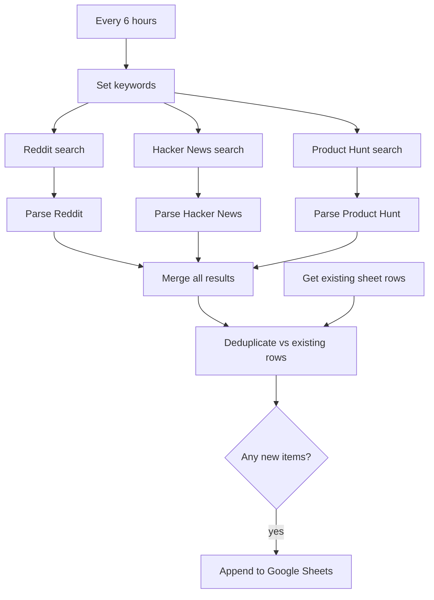

# 05 · Startup Grants & Opportunities Scraper

An n8n workflow that **watches the internet for startup funding opportunities** and logs them to a Google Sheet. Every 6 hours it searches Reddit, Hacker News and Product Hunt for grants, accelerators, pitch competitions, ideathons and hackathons, extracts the link and any deadline it can find, removes anything already logged, and appends the new items.

## What it does

1. **Every 6 hours** the workflow starts.
2. **Set Keywords** defines the search terms: `startup grant`, `pitch`, `accelerator`, `ideathon`, `hackathon`.
3. Three searches run in parallel:
   - **Reddit**: newest posts from the past day matching any keyword (25 results).
   - **Hacker News** (Algolia search API): stories from the last 6 hours matching any keyword (25 results).
   - **Product Hunt** (GraphQL API): the 20 newest posts, filtered locally by keyword in the name, tagline or topics.
4. Three **Code** nodes normalise each source into the same shape and pull out the first external link and a deadline date (using patterns such as "deadline", "closes", "apply by").
5. The results are merged and **de-duplicated against the sheet by post URL**.
6. If anything new is left, it is appended to `Sheet1`.

## Workflow diagram



## Before you start

| You need | Notes |
|---|---|
| n8n (Cloud or self-hosted) | See [common setup](../docs/common-setup.md) |
| Google Sheets OAuth2 credential | |
| Product Hunt API token | Create a developer token in your Product Hunt account. Optional: you can delete the Product Hunt branch to run with Reddit and Hacker News only |

Reddit and Hacker News need no key.

## Setup

1. **Import** [`workflow.json`](./workflow.json).
2. **Create the Google Sheet.** Make a tab called `Sheet1` and paste the headers from [`sheets/Sheet1.csv`](./sheets/Sheet1.csv):
   `Date Found, Platform, Post URL, Grant / Resource Link, Title, Start Date, Deadline, Author, Summary`
3. **Point the Sheets nodes at your sheet.** In **Get Existing Sheet Rows** and **Write to Google Sheets**, replace the `YOUR_GOOGLE_SHEET_ID` placeholder and attach your Google Sheets OAuth2 credential.
4. **Add the Product Hunt token.** In **Product Hunt Search**, replace `Bearer YOUR_PRODUCTHUNT_TOKEN` in the `Authorization` header (or move it to a Header Auth credential).
5. **Fix the two wiring items in "Known limitations" below** before activating.
6. Run once manually, check the sheet, then activate.

## Configuration reference

| Setting | Where | Default |
|---|---|---|
| Schedule | **Every 6 Hours** | 6 hours |
| Keywords | **Set Keywords**, the search strings in the Reddit and Hacker News nodes, and the `keywords` array inside each Parse node | `startup grant, pitch, accelerator, ideathon, hackathon` |
| Reddit window and size | **Reddit Search** query: `t=day`, `limit=25`, `sort=new` | past day, 25 posts |
| Hacker News window | **HackerNews Search** `numericFilters` | last 6 hours |
| Product Hunt size | GraphQL `first: 20` | 20 newest posts |

The keyword list is repeated in several places. To change it, update **all** of them.

## Output columns

| Column | Content |
|---|---|
| Date Found | When the workflow saw the item |
| Platform | Reddit, Hacker News or Product Hunt |
| Post URL | Link to the discussion (also the de-duplication key) |
| Grant / Resource Link | First external link found in the post |
| Title | Post title |
| Start Date | Currently always `Not found` |
| Deadline | First date found near words like deadline, closes, due, apply by (or any date pattern), else `Not found` |
| Author | Poster's username |
| Summary | First 300 characters of the post text |

## Known limitations

- **Existing rows are never loaded as exported.** **Get Existing Sheet Rows** has no incoming connection, so it does not run and the de-duplication step has nothing to compare against. Connect it from **Every 6 Hours** or **Set Keywords**.
- **The merge step needs changing.** **Merge All Results** is set to *Combine by position*, which pairs items from two inputs side by side rather than stacking them, and a Merge v3 node in that mode has two inputs while three branches feed it. Switch it to **Append** with 3 inputs so every source's items reach the de-duplication step.
- **Keyword matching is literal.** It is a plain substring match on the title and text. "pitch" will also match unrelated posts (for example a cricket pitch).
- **Deadlines are best-effort.** Dates are pulled with regular expressions and may be wrong or missing. Verify before relying on them.
- **Reddit can rate-limit or block unauthenticated requests**, especially from shared cloud IPs. Keep a descriptive `User-Agent` and consider Reddit's official OAuth API if you see failures.
- **The Product Hunt branch only scans the 20 newest posts.** Relevant launches older than that are missed between runs.
- **Overlapping windows.** The Reddit search covers a full day while the schedule is every 6 hours, which is why de-duplication matters.
- **Token in header.** Move the Product Hunt token to a credential before sharing exports.

## Ideas for extending it

- Add more sources (Devpost, X/Twitter lists, RSS feeds of grant databases).
- Add an LLM node to classify each item (grant vs hackathon vs accelerator) and summarise the eligibility in one line.
- Send new items to Telegram, Slack or email instead of, or in addition to, the sheet.

## Files

```
05-startup-grants-scraper/
├── README.md
├── workflow.json
└── sheets/
    └── Sheet1.csv
```
