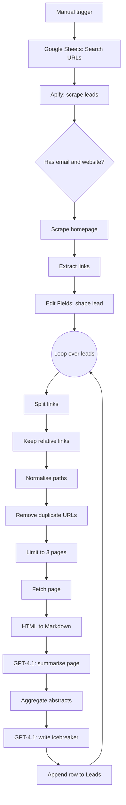
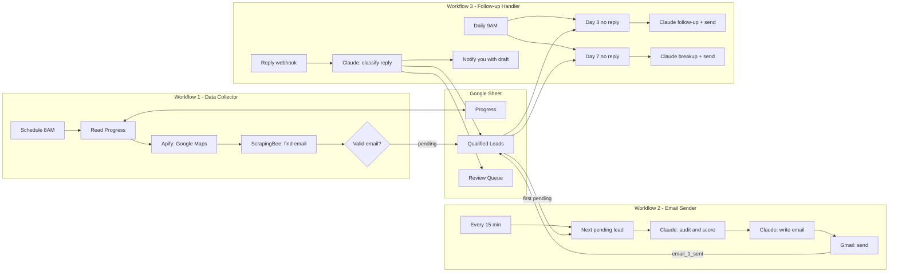
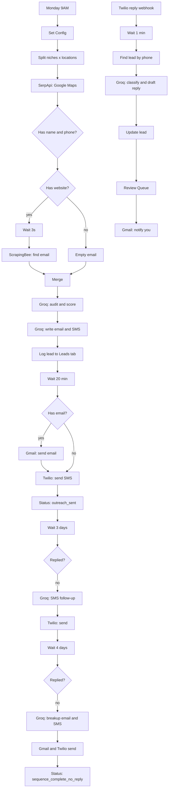
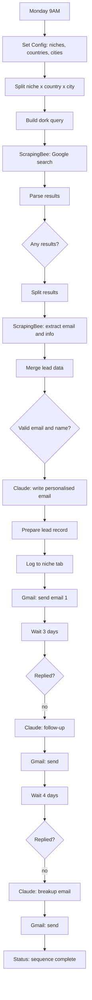
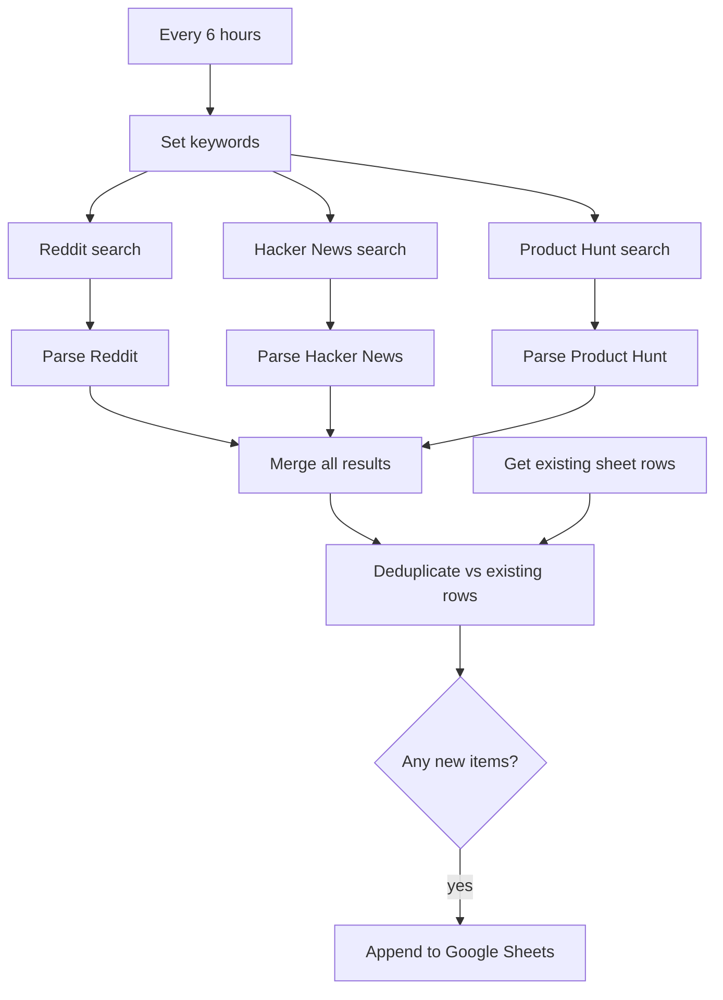

# n8n Automations

A collection of production-style [n8n](https://n8n.io) workflows I built for lead generation, AI-personalised outreach, and opportunity monitoring. Each project is a self-contained folder: import the workflow, create the Google Sheet from the CSV templates, add your API keys, and run it.

**Stack across the repo:** n8n · Anthropic Claude · OpenAI · Groq (Llama 3.3) · Apify · ScrapingBee · SerpApi · Twilio · Gmail · Google Sheets

## Projects

| # | Project | What it does | Trigger | Key services |
|---|---------|--------------|---------|--------------|
| 01 | [Deep Multiline Icebreaker](./01-deep-multiline-icebreaker) | Scrapes leads, reads several pages of each lead's website, and writes a deeply personalised multi-line cold email opener | Manual | Apify, OpenAI (GPT-4.1), Google Sheets |
| 02 | [Audit & Outreach Pipeline](./02-audit-outreach-pipeline) | Three connected workflows: find local businesses, score them with an AI audit, send a personalised email, follow up on day 3 and day 7, and triage replies | Daily + every 15 min + daily | Apify, ScrapingBee, Claude, Gmail, Google Sheets |
| 03 | [Multi-Channel Audit Outreach](./03-multichannel-audit-outreach) | Single long-running workflow that runs the audit-and-outreach idea over **email + SMS**, with an SMS reply webhook | Weekly | SerpApi, ScrapingBee, Groq, Twilio, Gmail, Google Sheets |
| 04 | [AI Lead Gen (Google Dorking)](./04-ai-lead-gen-dorking) | Finds businesses with Google search operators (dorks) instead of Maps, extracts emails, writes and sends a pitch, then follows up | Weekly | ScrapingBee, Claude, Gmail, Google Sheets |
| 05 | [Startup Grants Scraper](./05-startup-grants-scraper) | Watches Reddit, Hacker News and Product Hunt for grants, hackathons, accelerators and pitch competitions and logs new ones to a sheet | Every 6 hours | Reddit, Hacker News (Algolia), Product Hunt, Google Sheets |

Projects 02 to 04 share the same core idea (find local businesses, audit them, pitch them) and show how the design evolved. Each README has a short "Evolution" section describing earlier iterations.

## Repository layout

```
n8n-automations/
├── README.md
├── docs/
│   └── common-setup.md          # importing workflows, credentials, Google OAuth, testing
├── 01-deep-multiline-icebreaker/
│   ├── README.md
│   ├── workflow.json
│   └── sheets/                  # CSV headers for the Google Sheet tabs
├── 02-audit-outreach-pipeline/
│   ├── README.md
│   ├── workflows/               # 01-data-collector / 02-email-sender / 03-followup-handler
│   └── sheets/
├── 03-multichannel-audit-outreach/
├── 04-ai-lead-gen-dorking/
└── 05-startup-grants-scraper/
```

## Quick start (any project)

1. Open the project folder and read its README. The "Before you start" section lists the accounts and keys you need.
2. In n8n: **Workflows → Add workflow → ⋯ → Import from File** and pick the `workflow.json`.
3. Create a Google Sheet and import each CSV from the project's `sheets/` folder as its own tab. Tab names must match the file names.
4. Add your credentials and fill in the **Set Config** node. Full instructions are in [docs/common-setup.md](./docs/common-setup.md).
5. Run once manually, check the output, then activate.

## Important notes before you fork this

- **No secrets are included.** Every key is a `YOUR_..._HERE` placeholder and credential bindings were stripped from the exports. If you adapt these workflows, keep real keys in n8n credentials or environment variables and never commit them.
- **Cold outreach is regulated.** Cold email and especially SMS are covered by laws such as CAN-SPAM, GDPR/PECR, CASL and the TCPA, which differ by country. You are responsible for compliance: honest claims, a working opt-out, and permission where required. Start with small volumes and your own test inboxes.
- **Read each project's "Known limitations".** They list things I'd fix before running at volume.

## Author

Built by **Ayobami Bolade** ([@dottiebing](https://github.com/dottiebing)(https://ayobamibolade.netlify.app)), full-stack developer and AI engineer.

# 01 · Deep Multiline Icebreaker

An n8n workflow that turns a lead list into **deeply personalised cold-email openers**. It scrapes leads from a search URL, visits each lead's website, reads several of its pages, summarises them with GPT-4.1, and writes a multi-line icebreaker that proves "I actually read your site". Results are appended to a Google Sheet, ready to drop into a cold-email tool.

> **Credits:** the multiline-icebreaker pattern is widely shared in the n8n and lead-generation community and this workflow builds on it.

## What it does

1. Reads search URLs from a Google Sheet.
2. Calls an Apify lead-scraper actor for each URL (up to 500 records) and keeps only leads that have **both** an email and a website.
3. Fetches each lead's homepage and collects its internal links.
4. For every lead, takes up to **3 internal pages**, converts each to Markdown, and has GPT-4.1 write a two-paragraph abstract of each page.
5. Combines the abstracts and has GPT-4.1 write a short, specific, multi-line icebreaker using a fixed template.
6. Appends the lead plus the icebreaker to the `Leads` sheet.

## Workflow diagram



## Before you start

| You need | Notes |
|---|---|
| n8n (Cloud or self-hosted) | See [common setup](../docs/common-setup.md) |
| Google account | Google Sheets OAuth2 credential |
| OpenAI API key | Used by both GPT-4.1 nodes (OpenAI credential) |
| Apify account and API token | Used by the **Call Apify Scraper** node |
| A lead-source search URL | The Apify actor in this workflow takes a search URL (for example an Apollo-style people search) and returns people with emails and organisation websites |

## Setup

1. **Import** `workflow.json` into n8n.
2. **Create the Google Sheet** with two tabs from the [`sheets/`](./sheets) folder:
   - `Search URLs`: one column `URL`. Add one search URL per row.
   - `Leads`: output tab. Columns: `first_name, last_name, email, website_url, phone_number, location, multiline_icebreaker`.
3. **Connect credentials**
   - Both Google Sheets nodes (**Get Search URL**, **Add Row**): Google Sheets OAuth2.
   - Both OpenAI nodes (**Summarize Website Page**, **Generate Multiline Icebreaker**): OpenAI API.
4. **Point the Google Sheets nodes at your sheet.** The document ID is a `YOUR_GOOGLE_SHEET_ID` placeholder. Select your sheet in each node.
5. **Add your Apify token.** In **Call Apify Scraper**, replace `Bearer YOUR_APIFY_API_TOKEN` in the `Authorization` header (or switch the node to a Header Auth credential).
6. **Check the actor.** The URL contains an Apify actor ID. Use the actor you have access to, and adjust the JSON body if its input fields differ.
7. **Rewrite the pitch** in the **Generate Multiline Icebreaker** prompt (see below).
8. Click **Test workflow**. Start with one search URL and a low `totalRecords` value.

## Configuration reference

| Setting | Where | Default |
|---|---|---|
| Records per search URL | `totalRecords` in the **Call Apify Scraper** JSON body | `500` |
| Emails requested | `getPersonalEmails`, `getWorkEmails` in the same body | both `true` |
| Pages read per lead | **Limit** node, `maxItems` | `3` |
| Model | Both OpenAI nodes | `gpt-4.1` |
| Lead filter | **Only Websites & Emails** node | email and website must exist |

## Node breakdown

| Node | Purpose |
|---|---|
| **When clicking 'Test workflow'** | Manual start |
| **Get Search URL** | Reads the `Search URLs` tab |
| **Call Apify Scraper** | Synchronous Apify call that returns lead records |
| **Only Websites & Emails** | Drops leads without an email or website |
| **Scrape Home / HTML** | Downloads the homepage and extracts every `<a href>` |
| **Edit Fields** | Maps first name, last name, email, website, location and phone into a clean record |
| **Loop Over Items** | Processes leads one at a time |
| **Split Out / Filter / Code** | Turns the link array into items and keeps relative links, normalised to a path |
| **Remove Duplicate URLs / Limit** | De-duplicates and keeps the first 3 pages |
| **Request web page for URL / Markdown** | Fetches each page and converts it to Markdown |
| **Summarize Website Page** | GPT-4.1 returns `{"abstract": ...}` (two paragraphs, spartan tone) |
| **Aggregate** | Collects the page abstracts for a lead |
| **Generate Multiline Icebreaker** | GPT-4.1 returns `{"icebreaker": ...}` using a fixed template |
| **Add Row** | Appends the finished lead to `Leads` |

## The prompts

**Page summariser.** Input is the Markdown of one page. Output is JSON with a comprehensive two-paragraph abstract, written in a "straightforward, spartan tone", or `no content` for empty pages.

**Icebreaker writer.** Takes the abstracts and fills a fixed multi-line template: a short greeting that name-drops one small, non-obvious detail from the site, a line admitting you looked closely, and a one-sentence pitch. Rules baked into the prompt:

- spartan, laconic tone
- shorten company names and locations ("XYZ" not "XYZ Agency", "San Fran" not "San Francisco")
- use small, non-obvious details; no cookie-cutter praise like "Love your website!"

## Example output row

| first_name | email | website_url | multiline_icebreaker |
|---|---|---|---|
| Sam | sam@example.com | https://example.com | `Hey Sam. Love {small detail}, also a fan of {other detail}. Wanted to run something by you. ...` |

## Known limitations

- **Empty company name in the prompt.** The icebreaker prompt starts with "a business called ." because the company-name variable is missing. Add an organisation-name field in **Edit Fields** and reference it in the prompt.
- **The pitch text is a placeholder.** The template's pitch line describes a different product (an outreach system for finding people hiring web developers). Rewrite it for your own offer before sending anything.
- **Only relative links are followed.** Absolute links (including links to subdomains) are dropped, so a few sites will yield fewer than 3 pages.
- **Synchronous Apify call.** `run-sync-get-dataset-items` times out on long runs. For large lists, lower `totalRecords` or switch to an asynchronous run and poll for results.
- **Cost.** Every lead triggers up to 3 page summaries plus 1 icebreaker with GPT-4.1. Keep `totalRecords` low while testing.
- **Secrets.** The Apify token sits in a header on the node. Move it to a credential.

## Files

```
01-deep-multiline-icebreaker/
├── README.md
├── workflow.json
└── sheets/
    ├── Search URLs.csv
    └── Leads.csv
```
# 02 · Local Business Audit & Outreach Pipeline

A three-workflow n8n system that **finds local businesses, audits them with AI, sends a personalised cold email, follows up automatically, and triages replies**. The workflows are decoupled and communicate only through one Google Sheet, so each can be run, paused or debugged on its own.

| Workflow | File | Schedule | Job |
|---|---|---|---|
| **1 · Data Collector** | [`01-data-collector.json`](./workflows/01-data-collector.json) | Weekdays 8AM | Scrape Google Maps, extract emails, save qualified leads |
| **2 · Email Sender** | [`02-email-sender.json`](./workflows/02-email-sender.json) | Every 15 min, 9AM to 6PM weekdays | Audit one pending lead with Claude, write and send the first email |
| **3 · Follow-up Handler** | [`03-followup-handler.json`](./workflows/03-followup-handler.json) | Weekdays 9AM, plus a reply webhook | Day 3 follow-up, day 7 breakup email, reply analysis |

## Architecture



## Lead lifecycle

`pending` → `email_1_sent` → `followup_1_sent` → `sequence_complete`

A reply moves the lead to `interested`, `ready_for_audit`, `replied_followup_needed` or `opted_out` and sets `replied = true`, which stops further follow-ups.

## Before you start

| You need | Used by |
|---|---|
| n8n (Cloud or self-hosted), see [common setup](../docs/common-setup.md) | all |
| Google Sheets OAuth2 credential | all |
| Gmail OAuth2 credential | workflows 2 and 3 |
| [Apify](https://apify.com) API token (Google Maps crawler actor `compass~crawler-google-places`) | workflow 1 |
| [ScrapingBee](https://www.scrapingbee.com) API key | workflow 1 |
| [Anthropic](https://console.anthropic.com) API key | workflows 2 and 3 |
| Something that forwards email replies to the webhook (see below) | workflow 3, optional |

## Setup

### 1. Create the Google Sheet

Import the three CSVs in [`sheets/`](./sheets) as tabs with exactly these names:

- **`Progress`**: one row (`id = 1`) that stores where the crawler is. Workflow 1 reads and updates it.
- **`Qualified Leads`**: every lead and its status. All three workflows read and write it.
- **`Review Queue`**: replies that need a human, with an AI-drafted response.

### 2. Import the workflows

Import all three files from [`workflows/`](./workflows). Do not activate them yet.

### 3. Fill in each Set Config node

| Workflow | Fields to edit |
|---|---|
| 1 · Data Collector | `apify_key`, `scrapingbee_key`, `google_sheet_id`, `niches` |
| 2 · Email Sender | `anthropic_key`, `google_sheet_id`, `sender_email`, `sender_name` |
| 3 · Follow-up Handler | `anthropic_key`, `google_sheet_id`, `sender_email` |

Workflow 3 also has a **Find Lead By Email** node containing `=YOUR_GOOGLE_SHEET_ID_HERE`. Replace it with your sheet ID, and replace `YOUR_EMAIL@example.com` in **Gmail - Notify Ayo** with the address that should receive reply alerts.

### 4. Attach credentials

- Every **Google Sheets** node: Google Sheets OAuth2.
- Every **Gmail** node: Gmail OAuth2.

### 5. Test in this order

1. Run workflow 1 manually. Confirm rows appear in `Qualified Leads` with `status = pending`.
2. **Deactivate the Gmail send node** in workflow 2, or temporarily change the recipient to your own address, then run it once and read the subject, body and score.
3. Re-enable sending. Run workflow 3 manually to check the filters (it only acts on leads emailed 3 or 7 or more days ago).
4. Activate all three.

### 6. Reply handling (optional)

Workflow 3 exposes `POST /webhook/email-reply-webhook` and expects JSON with two fields:

```json
{ "from": "owner@business.com", "message": "Sounds interesting, send it over" }
```

n8n does not receive Gmail replies on its own. Pick one:

- Add a **Gmail Trigger** node (or a second small workflow) that POSTs each new reply to the webhook, or
- Forward replies from Zapier, Make or an Apps Script.

Without this, nothing sets `replied = true` automatically, so you must set it by hand to stop follow-ups.

## Workflow 1 · Data Collector

1. **Schedule** at 8AM on weekdays.
2. **Read Progress** loads the current town index and niche index. The built-in list has about 237 towns across the US, UK, Australia and Canada and 9 niches (dental clinic, medical clinic, hair salon, HVAC company, plumber, law firm, real estate agent, gym, restaurant).
3. **Apify** searches Google Maps for `{niche} {town} {state} {country}` and returns up to 10 places.
4. Keeps places that have a name and a website.
5. Waits 3 seconds, then **ScrapingBee** fetches the site and extracts `mailto:` links plus a simple call-to-action signal.
6. Keeps leads with a valid email, excluding `noreply`, `no-reply`, `donotreply`, `webmaster@` and `postmaster@`.
7. Appends the lead to `Qualified Leads` with `status = pending`, then advances `Progress` to the next niche (and the next town once all niches are done).

## Workflow 2 · Email Sender

1. Runs every 15 minutes between 9AM and 6PM on weekdays (cron `*/15 9-18 * * 1-5`).
2. Picks the first `Qualified Leads` row with `status = pending`. If there is none, it stops.
3. **Claude audit.** Scores the business out of 100 and returns JSON with a grade, findings, recommendations, pain points and a one-line pitch angle.
4. **Claude email.** Writes a personalised cold email of at most 120 words (JSON with `subject` and `body`).
5. Updates the sheet (`email_1_sent`, subject, body, score, grade, `analysis_json`, `date_emailed`), then sends through Gmail.

Throughput is one lead per tick, so at most about 40 emails per weekday.

### Audit scoring rubric

| Signal | Max points |
|---|---|
| Google review count | 25 |
| Review rating | 15 |
| Owner response rate | 15 |
| Photo count | 10 |
| Website quality (has a call-to-action) | 20 |
| Business description | 5 |
| Call answering | 10 (see limitations) |

The model also assigns a category: `needs_website`, `needs_ai_receptionist` or `needs_both`, which steers the angle of the email.

## Workflow 3 · Follow-up Handler

Three independent branches:

- **Day 3.** Leads with `status = email_1_sent`, at least 3 days since `date_emailed`, and not replied. Claude writes a follow-up of under 80 words with one new angle. Sends it and sets `followup_1_sent`.
- **Day 7.** Leads with `status = followup_1_sent`, at least 7 days since `date_emailed`, and not replied. Claude writes a warm breakup email of under 60 words. Sends it and sets `status = sequence_complete`.
- **Replies.** The webhook receives a reply, waits 1 minute, finds the lead by email, and asks Claude to classify the sentiment (`POSITIVE`, `NEUTRAL`, `NEGATIVE`, `READY`) and draft a response of under 100 words. The lead row is updated, the reply is appended to `Review Queue`, and you get an email with the draft. **Nothing is sent to the lead automatically.** A human approves every reply.

## Data schema

**Qualified Leads** (key columns)

| Column | Written by | Meaning |
|---|---|---|
| `business_name, email, phone, website, address, town, state, country, niche, category` | W1 | Lead details |
| `rating, review_count, photos_count, description, owner_answers, has_cta` | W1 | Signals used by the audit |
| `status` | W1, W2, W3 | Lifecycle state (see above) |
| `replied, reply_sentiment` | W3 | Reply tracking |
| `total_score, grade, analysis_json` | W2 | AI audit result |
| `email_subject, email_body` | W2 | The first email as sent |
| `date_added, date_emailed` | W1, W2 | Timestamps used by the follow-up filters |
| `followup_1_sent, followup_2_sent` | W3 | Follow-up flags |

## Known limitations

- **The "call test" is not real.** The audit and email prompts assume that you tried to phone the business and nobody answered, and instruct the model to mention it. None of these workflows places a call, and the score for that item is hard-coded. Either add a real calling step (for example an AI receptionist test call) or remove those lines from the prompts. Otherwise the emails state something that did not happen.
- **No duplicate check in workflow 1.** The earlier single-workflow version checked for an existing email before saving. Add a lookup on `Qualified Leads` before **Save to Qualified Leads** if the same business can appear in several searches.
- **Slow coverage by default.** Workflow 1 runs one niche and town per run, once per weekday. Roughly 2,100 town and niche combinations would take years at that pace. Raise the trigger frequency once you are happy with lead quality.
- **`total_leads` is read but never incremented.**
- **Status is updated before the email is sent.** If Gmail fails, the lead is already marked `email_1_sent`.
- **Weak website signal.** `has_cta` is a rough selector check (booking, appointment or contact links, or any button), so treat the website score as indicative only.
- **Replies need an external forwarder** (see Setup, step 6).
- **API keys sit in Set Config nodes.** Move them to credentials before sharing exports.
- **Deliverability.** Use a dedicated sending domain, warm it up, and keep volumes low. Include a clear way to opt out.

## Evolution of this system

1. **v1** · A single weekly workflow: Outscraper for Google Maps, ScrapingBee for emails, Claude for audit and email, with 20-minute waits and a 3-day and 7-day follow-up inside the same execution.
2. **Data collection v1** · Split lead collection into its own all-states workflow using SerpApi and a 30-minute batch interval.
3. **FINAL** · Moved to Apify, added a rotating town and niche progress tracker, a duplicate-email check and a webhook for replies, still in one workflow.
4. **FINAL v2** · Expanded the town list from about 200 to about 530 towns.
5. **Current (this folder)** · Split into three decoupled workflows connected through the sheet, which makes each part easy to run and debug on its own.

For the version that adds SMS and Groq, see [03 · Multi-Channel Audit Outreach](../03-multichannel-audit-outreach).

## Files

```
02-audit-outreach-pipeline/
├── README.md
├── workflows/
│   ├── 01-data-collector.json
│   ├── 02-email-sender.json
│   └── 03-followup-handler.json
└── sheets/
    ├── Progress.csv
    ├── Qualified Leads.csv
    └── Review Queue.csv
```
# 03 · Multi-Channel Audit Outreach (Email + SMS, Groq)

A single long-running n8n workflow that runs the **audit-and-outreach** idea across **two channels**. It finds local businesses on Google Maps, scores them with an LLM, then contacts them by email and SMS, follows up, and handles SMS replies through a Twilio webhook.

This version runs entirely on **Groq's Llama 3.3 70B** (`llama-3.3-70b-versatile`) through Groq's OpenAI-compatible API, so there is no Anthropic or OpenAI key to manage. For the more modular, email-only design, see [02 · Audit & Outreach Pipeline](../02-audit-outreach-pipeline).

## What it does

1. **Weekly trigger** (Monday 9AM) loops over 9 niches × 9 locations (81 searches) using SerpApi's Google Maps engine, 10 results each.
2. Keeps businesses that have a **name and a phone number**.
3. If a business has a website, waits 3 seconds and uses **ScrapingBee** to pull a contact email and a call-to-action signal. If not, the email stays empty.
4. **Groq audit.** Scores the business out of 100 and returns a grade, findings, pain points and a pitch angle.
5. **Groq copy.** Writes a cold email (at most 120 words) and an SMS (at most 160 characters) in one call.
6. Logs the lead to the `Leads` tab, waits 20 minutes, then:
   - sends the email through Gmail (if an email was found), and
   - sends the SMS through Twilio.
7. **Day 3:** if there is no reply, sends an SMS follow-up.
8. **Day 7:** if still no reply, sends a breakup email and a breakup SMS, then marks the lead `sequence_complete_no_reply`.
9. **Replies** (separate branch): Twilio posts incoming SMS to an n8n webhook. Groq classifies the reply and drafts a response, the lead is updated, the reply goes into `Review Queue`, and you receive an email alert. Nothing is auto-sent back to the lead.

## Workflow diagram



## Before you start

| You need | Notes |
|---|---|
| n8n (Cloud or self-hosted) | See [common setup](../docs/common-setup.md). Needs a publicly reachable URL for the Twilio webhook |
| Google Sheets and Gmail OAuth2 credentials | |
| [SerpApi](https://serpapi.com) key | Google Maps search |
| [ScrapingBee](https://www.scrapingbee.com) key | Email extraction from websites |
| [Groq](https://console.groq.com) API key | LLM calls |
| [Twilio](https://www.twilio.com) account, SMS-capable number | Outbound SMS and inbound reply webhook |

## Setup

1. **Import** [`workflow.json`](./workflow.json).
2. **Create the Google Sheet** with the two tabs in [`sheets/`](./sheets): `Leads` and `Review Queue`.
3. **Fill in the Set Config node.**

   | Field | Value |
   |---|---|
   | `niches`, `locations` | Arrays of search terms. Defaults: 9 niches and 9 cities across the US, UK, Australia and Canada |
   | `sender_name`, `sender_email` | Your name and reply-to address |
   | `serpapi_key`, `scrapingbee_key`, `groq_key` | Your API keys |
   | `google_sheet_id` | The ID of your sheet |
   | `twilio_account_sid`, `twilio_auth_token`, `twilio_phone` | Twilio details; `twilio_phone` is your sending number in E.164 format (`+15551234567`) |

4. **Groq reply node.** In **Groq - Analyse Reply**, replace `YOUR_GROQ_API_KEY_HERE` in the `Authorization` header with your key. (This node runs from the webhook branch, so it cannot read `groq_key` from Set Config.)
5. **Twilio credential.** Create an **HTTP Basic Auth** credential (username = Account SID, password = Auth Token) and attach it to the three Twilio nodes: **Twilio - Send SMS**, **Twilio - Send SMS Follow-up 1**, **Twilio - Send Breakup SMS**.
6. **Google credentials.** Attach Google Sheets OAuth2 to every Sheets node and Gmail OAuth2 to the Gmail nodes.
7. **Notification address.** In **Gmail - Notify Ayo**, replace `YOUR_EMAIL@example.com`.
8. **Webhook.** Activate the workflow, copy the **Production URL** of **Twilio Reply Webhook** (`/webhook/twilio-reply-webhook`), and in the Twilio console set it as the "A message comes in" webhook (HTTP POST) for your number. Twilio sends `From` and `Body`, which the workflow reads.
9. **Test small first.** Shrink `niches` and `locations` to one each, and deactivate the Gmail and Twilio send nodes (or use your own email and phone) for the first run.

## Configuration reference

| Setting | Where | Default |
|---|---|---|
| Schedule | **Weekly Trigger** | `0 9 * * 1` (Monday 9AM) |
| Results per search | SerpApi `num` parameter | `10` |
| Delay before sending | **Wait 20 Minutes** | 20 minutes |
| Follow-up timing | **Wait 3 Days**, **Wait 4 More Days** | Day 3, Day 7 |
| Model | All Groq nodes | `llama-3.3-70b-versatile` |
| Scrape rate limit | **Wait 3 Seconds (Rate Limit)** | 3 seconds |

## Sheet schema

**Leads**: `business_name, email, phone, website, has_website, address, location, niche, rating, review_count, hours, category, total_score, grade, analysis_json, email_subject, email_body, sms_body, status, replied, reply_sentiment, audit_sent, date_added`

Status values: `pending_send`, `outreach_sent`, `sequence_complete_no_reply`, `opted_out`, `ready_for_audit`, `replied_needs_followup`.

**Review Queue**: `business_name, phone, their_reply, sentiment, suggested_reply, action, reviewed, timestamp`

Leads are matched by `phone`, so each business needs a unique phone number in the sheet.

## Known limitations

- **The "call test" is not real.** The audit, email and SMS prompts assume you tried to phone the business and nobody answered, and tell the model to mention the "missed call". No node in this workflow places a call, and the call-answering score is hard-coded. Either add a real calling step or remove those lines from the prompts, otherwise the messages state something that did not happen.
- **Phone numbers are not normalised.** Google Maps returns numbers in local formats, but Twilio needs E.164 (`+15551234567`). Add a formatting step before **Twilio - Send SMS**, or sends will fail.
- **Landlines can't receive SMS.** Many business listings are landlines, so expect a share of delivery failures.
- **The 20-minute wait delays, it doesn't space.** The Wait node holds all items for the same interval and releases them together. To throttle sending, add **Loop Over Items** with a Wait inside the loop.
- **`your_whatsapp` and the WhatsApp idea are unused.** The field is passed along but no node sends WhatsApp messages.
- **Follow-up 1 is SMS only.** Day 3 sends no email, only an SMS.
- **Long executions.** Each lead waits 7 days inside one execution, so a big run leaves many executions in "waiting". Check your n8n execution retention and database size.
- **Reply matching depends on the phone number.** Replies from a different number than the one in the sheet won't match a lead.
- **SMS is the most heavily regulated channel.** In many countries, including the US (TCPA), commercial texts need prior consent or specific safeguards, and opt-out handling is mandatory. Get advice before texting at volume.
- **API keys in Set Config.** Move them to credentials before sharing exports.

## Evolution

1. **v1** · Outscraper for Google Maps, ScrapingBee for emails, Claude for audit and copy. Email only, with 20-minute waits and day 3 and day 7 follow-ups.
2. **v2** · Added Twilio SMS, a Twilio reply webhook, reply classification and a `Review Queue`. Used Outscraper's own email field as a shortcut before scraping the site.
3. **v3** · Replaced Outscraper with SerpApi's Google Maps engine and added an email alert for new replies.
4. **v4 (this folder)** · Replaced Claude with Groq's Llama 3.3 70B and added a 3-second delay before scraping to stay within rate limits.

## Files

```
03-multichannel-audit-outreach/
├── README.md
├── workflow.json
└── sheets/
    ├── Leads.csv
    └── Review Queue.csv
```
# 04 · AI Lead Gen & Cold Email (Google Dorking)

An n8n workflow that finds local businesses **without the Google Maps API**. It builds Google search-operator queries ("dorks") per niche and city, scrapes the results, pulls a contact email from each site, has Claude write a personalised pitch for an **AI phone agent**, sends it through Gmail, and follows up automatically.

## What it does

1. **Weekly trigger** (Monday 9AM).
2. **Set Config** holds 9 niches, each with its own dork string (for example `"dental clinic" ("book appointment" OR "contact us" OR "schedule")`), and 4 countries (US, UK, Australia, Canada), each with a country-specific Google domain and 5 cities.
3. **Build Dork Query** combines niche, city and a block of exclusions (`-site:yelp.com -site:yellowpages.com -site:tripadvisor.com -site:healthgrades.com -site:thumbtack.com -site:angi.com`) so results are real business sites rather than directories.
4. **ScrapingBee** loads the Google results page (top 5) with CSS extraction rules for title, URL and snippet.
5. Each result is fetched again to extract a contact email and basic info.
6. Keeps leads with a valid email and a business name.
7. **Claude** writes a personalised email (at most 150 words) using the business name, niche, city and the site snippet.
8. Logs the lead to a **sheet tab named after the niche**, then sends the email.
9. **Day 3:** if `replied` is not `true`, Claude writes a short follow-up. **Day 7:** a breakup email. Then the lead is marked complete.

## Workflow diagram



## Before you start

| You need | Notes |
|---|---|
| n8n (Cloud or self-hosted) | See [common setup](../docs/common-setup.md) |
| Google Sheets and Gmail OAuth2 credentials | |
| [ScrapingBee](https://www.scrapingbee.com) API key | Used for the Google search **and** for email extraction |
| [Anthropic](https://console.anthropic.com) API key | Email writing |

## Setup

1. **Import** [`workflow.json`](./workflow.json).
2. **Create the Google Sheet.** Create one tab **per niche**, named exactly as the `sheet` value in Set Config (`dental clinic`, `medical clinic`, `hair salon`, `HVAC company`, `plumber`, `law firm`, `real estate agent`, `gym`, `restaurant`). Paste the headers from [`sheets/niche-tab-template.csv`](./sheets/niche-tab-template.csv) into each tab.
3. **Edit Set Config.**

   | Field | Value |
   |---|---|
   | `scrapingbee_key` | ScrapingBee key |
   | `anthropic_key` | Anthropic key |
   | `google_sheet_id` | Sheet ID |
   | `sender_name`, `sender_full_name`, `sender_email` | Your sending identity |
   | `niches` | Add or remove niches, each with `name`, `sheet` (tab name) and `dork` |
   | `countries` | Add or remove countries, each with a Google domain and a list of cities |

4. **Attach credentials**: Google Sheets OAuth2 to every Sheets node, Gmail OAuth2 to every Gmail node.
5. **Test with one niche and one city**, with the Gmail nodes deactivated, and inspect the scraped results and generated emails.
6. Activate.

## The email prompt

Claude is briefed as a cold-email copywriter for a seller of an **AI phone agent** for local businesses (answers calls 24/7, books appointments, answers FAQs, follows up with leads, handles several calls at once, sounds human). Rules in the prompt: curiosity-driven non-salesy subject, a hyper-specific opening, one pain point (missed calls are missed revenue), one soft CTA, under 150 words, conversational tone, signed by the sender. Output is strict JSON: `{"subject": "...", "body": "..."}`.

Rewrite the product description in the prompt if you sell something else.

## Sheet schema (per niche tab)

`business_name, email, website, phone, niche_name, country_name, city, email_subject, email_body, date_added, status, replied, follow_up_1_date, follow_up_2_date`

`status` starts as `email_1_sent`. `replied` starts as `false`.

## Known limitations

- **Scraping Google results is fragile.** The extraction rules depend on Google's current page structure (CSS selectors such as `div.g`, `h3` and `div.VwiC3b`). When Google changes its markup the search step returns nothing. Scraping search results may also conflict with Google's terms of service. A search API such as SerpApi is the more stable option (see project 03).
- **Reply detection is manual.** Nothing sets `replied` for you. Mark the cell `true` when someone answers, or follow-ups will keep going. Project 02 shows an automated approach with a reply webhook.
- **Auto-mapped columns.** The sheet append uses automatic column mapping, so tab headers must match the field names above, and every niche tab needs the same headers.
- **One tab per niche.** Adding a niche means adding a matching tab, or the append fails.
- **Email quality varies.** The email is the first `mailto:` link found, which is often a generic info@ address. Review a sample before scaling.
- **API keys in Set Config.** Move them to credentials before sharing exports.
- **Deliverability and consent.** Use a dedicated sending domain, keep volumes low, and include a clear way to opt out. Check the rules in your target countries.

## Evolution

1. **v1** · Apify Google Maps crawler for discovery, ScrapingBee for emails, Claude for the pitch, with a flat list of `niche + location` searches and one tab per niche.
2. **v2 (this folder)** · Replaced Maps scraping with Google dorking: per-niche dork strings, directory exclusions, country-specific Google domains and city lists, plus a site-snippet passed to Claude for more specific openers.

## Files

```
04-ai-lead-gen-dorking/
├── README.md
├── workflow.json
└── sheets/
    └── niche-tab-template.csv
```
# 05 · Startup Grants & Opportunities Scraper

An n8n workflow that **watches the internet for startup funding opportunities** and logs them to a Google Sheet. Every 6 hours it searches Reddit, Hacker News and Product Hunt for grants, accelerators, pitch competitions, ideathons and hackathons, extracts the link and any deadline it can find, removes anything already logged, and appends the new items.

## What it does

1. **Every 6 hours** the workflow starts.
2. **Set Keywords** defines the search terms: `startup grant`, `pitch`, `accelerator`, `ideathon`, `hackathon`.
3. Three searches run in parallel:
   - **Reddit**: newest posts from the past day matching any keyword (25 results).
   - **Hacker News** (Algolia search API): stories from the last 6 hours matching any keyword (25 results).
   - **Product Hunt** (GraphQL API): the 20 newest posts, filtered locally by keyword in the name, tagline or topics.
4. Three **Code** nodes normalise each source into the same shape and pull out the first external link and a deadline date (using patterns such as "deadline", "closes", "apply by").
5. The results are merged and **de-duplicated against the sheet by post URL**.
6. If anything new is left, it is appended to `Sheet1`.

## Workflow diagram



## Before you start

| You need | Notes |
|---|---|
| n8n (Cloud or self-hosted) | See [common setup](../docs/common-setup.md) |
| Google Sheets OAuth2 credential | |
| Product Hunt API token | Create a developer token in your Product Hunt account. Optional: you can delete the Product Hunt branch to run with Reddit and Hacker News only |

Reddit and Hacker News need no key.

## Setup

1. **Import** [`workflow.json`](./workflow.json).
2. **Create the Google Sheet.** Make a tab called `Sheet1` and paste the headers from [`sheets/Sheet1.csv`](./sheets/Sheet1.csv):
   `Date Found, Platform, Post URL, Grant / Resource Link, Title, Start Date, Deadline, Author, Summary`
3. **Point the Sheets nodes at your sheet.** In **Get Existing Sheet Rows** and **Write to Google Sheets**, replace the `YOUR_GOOGLE_SHEET_ID` placeholder and attach your Google Sheets OAuth2 credential.
4. **Add the Product Hunt token.** In **Product Hunt Search**, replace `Bearer YOUR_PRODUCTHUNT_TOKEN` in the `Authorization` header (or move it to a Header Auth credential).
5. **Fix the two wiring items in "Known limitations" below** before activating.
6. Run once manually, check the sheet, then activate.

## Configuration reference

| Setting | Where | Default |
|---|---|---|
| Schedule | **Every 6 Hours** | 6 hours |
| Keywords | **Set Keywords**, the search strings in the Reddit and Hacker News nodes, and the `keywords` array inside each Parse node | `startup grant, pitch, accelerator, ideathon, hackathon` |
| Reddit window and size | **Reddit Search** query: `t=day`, `limit=25`, `sort=new` | past day, 25 posts |
| Hacker News window | **HackerNews Search** `numericFilters` | last 6 hours |
| Product Hunt size | GraphQL `first: 20` | 20 newest posts |

The keyword list is repeated in several places. To change it, update **all** of them.

## Output columns

| Column | Content |
|---|---|
| Date Found | When the workflow saw the item |
| Platform | Reddit, Hacker News or Product Hunt |
| Post URL | Link to the discussion (also the de-duplication key) |
| Grant / Resource Link | First external link found in the post |
| Title | Post title |
| Start Date | Currently always `Not found` |
| Deadline | First date found near words like deadline, closes, due, apply by (or any date pattern), else `Not found` |
| Author | Poster's username |
| Summary | First 300 characters of the post text |

## Known limitations

- **Existing rows are never loaded as exported.** **Get Existing Sheet Rows** has no incoming connection, so it does not run and the de-duplication step has nothing to compare against. Connect it from **Every 6 Hours** or **Set Keywords**.
- **The merge step needs changing.** **Merge All Results** is set to *Combine by position*, which pairs items from two inputs side by side rather than stacking them, and a Merge v3 node in that mode has two inputs while three branches feed it. Switch it to **Append** with 3 inputs so every source's items reach the de-duplication step.
- **Keyword matching is literal.** It is a plain substring match on the title and text. "pitch" will also match unrelated posts (for example a cricket pitch).
- **Deadlines are best-effort.** Dates are pulled with regular expressions and may be wrong or missing. Verify before relying on them.
- **Reddit can rate-limit or block unauthenticated requests**, especially from shared cloud IPs. Keep a descriptive `User-Agent` and consider Reddit's official OAuth API if you see failures.
- **The Product Hunt branch only scans the 20 newest posts.** Relevant launches older than that are missed between runs.
- **Overlapping windows.** The Reddit search covers a full day while the schedule is every 6 hours, which is why de-duplication matters.
- **Token in header.** Move the Product Hunt token to a credential before sharing exports.

## Ideas for extending it

- Add more sources (Devpost, X/Twitter lists, RSS feeds of grant databases).
- Add an LLM node to classify each item (grant vs hackathon vs accelerator) and summarise the eligibility in one line.
- Send new items to Telegram, Slack or email instead of, or in addition to, the sheet.

## Files

```
05-startup-grants-scraper/
├── README.md
├── workflow.json
└── sheets/
    └── Sheet1.csv
```
# Common setup

Everything in this guide applies to all projects in this repository.

## 1. Requirements

- An n8n instance: [n8n Cloud](https://n8n.io) or self-hosted (Docker is the easiest route). The exports use current node versions (Gmail v2.1, Google Sheets v4.4/4.5, Merge v3), so use a recent 1.x release.
- A Google account for Google Sheets and (for most projects) Gmail.
- The API keys listed in each project's README.

## 2. Import a workflow

1. In n8n, create a new workflow.
2. Click the **⋯** menu (top right) → **Import from File**.
3. Select the `workflow.json` from the project folder.
4. The workflow imports **inactive**. Leave it that way until you have finished setup.

Credentials are not included in the exports. After import, nodes that need one show a warning icon. Open them and attach your own credential.

## 3. Create the Google Sheet

Each project has a `sheets/` folder with one CSV per tab.

1. Create a new Google Sheet.
2. For each CSV: **File → Import → Upload → Insert new sheet(s)**, then rename the tab to match the CSV file name exactly (for example `Qualified Leads`).
3. Copy the sheet ID from the URL (`https://docs.google.com/spreadsheets/d/<THIS_PART>/edit`). You will paste it into the workflow's config.

Column names are used for lookups and updates, so do not rename them.

## 4. Credentials

| Credential | Used for | How to create in n8n |
|---|---|---|
| **Google Sheets OAuth2** | Reading and writing leads | Credentials → New → Google Sheets OAuth2 API. See [n8n's Google credentials guide](https://docs.n8n.io/integrations/builtin/credentials/google/). Self-hosted installs need their own Google Cloud OAuth client. |
| **Gmail OAuth2** | Sending emails | Credentials → New → Gmail OAuth2 API (same Google Cloud setup) |
| **OpenAI API** | Project 01 | Credentials → New → OpenAI API |
| **HTTP Basic Auth** | Twilio (project 03) | Username = Twilio Account SID, password = Auth Token |

## 5. API keys in the Set Config node

Most workflows read their API keys from a **Set Config** node near the start (for example `anthropic_key`, `scrapingbee_key`, `apify_key`). Replace each `YOUR_..._HERE` value with your real key.

This is convenient for a demo, but it means your keys live inside the workflow JSON. For anything beyond testing:

- Move keys into n8n credentials (Header Auth or Query Auth) and attach them to the HTTP Request nodes, or
- Use environment variables (`{{ $env.ANTHROPIC_API_KEY }}`) on self-hosted n8n.

Never export a workflow that contains real keys to a public repository.

## 6. Test safely

- Run the workflow manually with **Execute Workflow** before activating.
- While testing, **disable the Gmail/Twilio send nodes** (right-click → Deactivate) so nothing goes out to real people, or point the recipient at your own address.
- Use small limits first (fewer niches/locations, a lower result count) to keep API costs predictable.
- Check the first few generated emails by eye before you let it run unattended.

## 7. Webhooks and reply handling

Some projects include a webhook for replies:

- Use the **Production URL** of the webhook node once the workflow is active (the Test URL only works while you are listening in the editor).
- Gmail does not push replies to webhooks by itself. Projects 02 and 03 describe what needs to forward replies to the webhook.

## 8. Time zone

Schedule triggers use your n8n time zone (instance settings on n8n Cloud, or the `GENERIC_TIMEZONE` environment variable when self-hosting; a workflow can also override it in its own settings). Set it before activating, because the sending windows (for example 9AM to 6PM weekdays) depend on it.

## 9. Responsible use

These workflows contact real people. Use accurate claims in the generated copy, include a way to opt out, honour opt-outs, respect the laws of the countries you target, and respect the terms of the services you scrape. When in doubt, send less.

## Author

Built by **Ayobami Bolade** ([@dottiebing](https://github.com/dottiebing)(https://ayobamibolade.netlify.app)), full-stack developer and AI engineer.
